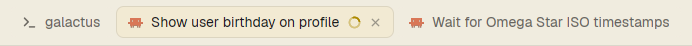

# Auto tabs for herdr

A [herdr](https://herdr.dev) mod that names your tabs for you.



- A Claude Code tab takes the title Claude gives the conversation.
- A terminal tab shows the program running in it, such as "Python", or its folder when the shell is at the prompt.
- Tab names can be up to 280px wide, instead of 170px.
- If you rename a tab yourself, the mod leaves it alone. To hand the tab back to the mod, rename it to "Claude Code", or clear the name.

Apart from this, the mod is herdr's own tab bar, unchanged. It runs no programs, reads no files and makes no network requests.

## Install

The quickest way is to ask the agent you use with herdr to add `https://github.com/longwave/herdr-auto-tabs`.

To install it by hand:

1. Copy the mod into herdr's mods folder:

   ```sh
   cp -r mods/auto-tabs ~/.config/herdr-app/mods/
   ```

2. Clone the main layout. herdr restores its own layouts on every start, so you need your own copy to change. This also switches you to the copy.

   ```sh
   herdr-app do layout.clone '{"name":"main","as":"my-main"}'
   ```

3. Point the copy's tab bar at this mod:

   ```sh
   sed -i 's/"mod": "tabs"/"mod": "auto-tabs"/' ~/.config/herdr-app/layouts/my-main.json
   ```

4. Check the mod loads:

   ```sh
   herdr-app check ~/.config/herdr-app/mods/auto-tabs
   ```

If the tabs aren't renamed within a few seconds, restart herdr.

To uninstall, switch back to the main layout with Ctrl+Shift+L, then delete `~/.config/herdr-app/mods/auto-tabs` and `~/.config/herdr-app/layouts/my-main.json`.

## Limits

- Only Claude Code tabs get conversation titles. Tabs for other agents keep the agent's name.
- Terminal tabs show the program's name but not its arguments.
- A new Claude tab may show its folder name until Claude sets a title.
- The mod only runs in layouts that use it as their tab bar.

## Building it yourself

[RECIPE.md](RECIPE.md) describes the mod in enough detail for an agent to build it from an empty folder.
