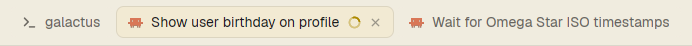

# Auto tabs

Herdr's tab bar, with tabs that name themselves. A Claude Code tab takes the title Claude gives its conversation. A terminal tab shows the program running in it, or its folder when the shell is at the prompt. Tab names can be up to 280px wide before they are cut off with "…". If you rename a tab yourself, the mod leaves it alone.

## What you see

The bar runs across the top of the work area, in a layout block 42px high. From left to right:

- **Tabs** for the active space, in a row that scrolls sideways when full. Each tab is 29px high, with 10px side padding, a 7px gap between its parts, 7px rounded corners and 12.8px text. It shows:
  - the program's icon (14px): tinted with `muted` if the program's icon is tinted, otherwise full colour;
  - the name, at most 280px wide, cut off with "…"; " Z" is added while the tab is zoomed;
  - a status mark (see below);
  - on the active tab only, a 12px close icon in `dim`.
- **+** (26px square button).
- **Files** and **Changes** buttons (26px high, 12px text, 14px icon), if those panels are enabled.
- **Minimize, maximize and close** buttons (26px square), only when `window().buttons` is set.

Colours are theme names. The bar is `chrome` with a 1px `border` line along its bottom edge. The active tab is `raised` with a 1px `border` outline and `foreground` text. Other tabs are `chrome` with a `chrome` outline and `muted` text. Hovering a tab or button shows `hover`. An open Files or Changes panel shows its button in `selected`.

### Tab names

The mod checks every tab every 3 seconds and names it from one pane: the tab's Claude Code pane if it has one, otherwise its first terminal pane.

| Pane | Name | Example |
|---|---|---|
| Claude Code | the terminal title Claude sets, without its leading spinner or ✳ | Show user birthday on profile |
| Shell running a program | the program's display name | Python, Neovim |
| Shell at the prompt | the last part of its folder; `~` in the home folder | my-app |

## How it behaves

- **Agent status** on each tab, using the most urgent status of the agents in it:
  - working: a 12px spinner in `working`, turning once every 900ms;
  - blocked: a 6px dot in `blocked`;
  - done: a 6px dot in `done`;
  - idle: no mark.
- **Click** a tab to select it. **Double-click** to rename it. **Right-click** opens the shipped `menu` mod as a 200px popup with Rename, New tab and Close.
- **Drag** a tab by pressing on it and releasing on another tab: it moves to that tab's position.
- **Scroll** over the bar to go to the previous or next tab.
- **+** opens the shipped `new-menu` mod as a 250 × 512px popup.
- **Files / Changes** open that panel, or close it if it is already showing. Each space remembers which panel was open and restores it when you switch back.
- **Renaming:** a tab is renamed only when it has no name yet, still has the new-tab menu's default name "Claude Code", or still has the name the mod last gave it. Once you rename it, it keeps your name. Renaming it to "" (its number) or "Claude Code" hands it back to the mod.

## Built from

- `mods/auto-tabs/main.js`: a clone of Herdr's shipped `tabs` mod (`mod.clone {name: "tabs", as: "auto-tabs"}`) with two changes. The name's `max_w` goes from 170 to 280. `init(_props, cx)` starts `cx.timer.every(3000, () => syncNames())`.
- `mods/auto-tabs/names.js`: `syncNames()`.
  - Reads `spaces()` (each tab's `id`, `name`, `named`) and `panes()` (`tab`, `terminal`, `app`, `title`, `cwd`, `program.shell`, `program.name`).
  - Calls `run("tab.rename", {id, name})`.
  - Remembers the names it gave in `shared("tab-titles.set")`, a map of tab id to name. It drops tabs that no longer exist and writes with `setShared` only when the map changes.
- `mods/auto-tabs/mod.json`: `{ "place": "none", "title": "Auto tabs" }`.
- Inherited from `tabs`, unchanged:
  - `spaces`, `panes`, `run`, `openOverlay`, `theme`, `window`, `shared`, `layout`, `settings`, and `localStorage` key `panels`;
  - the `menu` and `new-menu` mods;
  - icons `mods/workspace-chrome/spinner.svg`, `mods/pane/close.svg`, `mods/files/file.svg`, `mods/changes/changes.svg`;
  - layout nodes `sidebar`, `panel`, `panel-body` and the shared key `workspace.panels`;
  - commands `tab.select`, `tab.move`, `tab.rename`, `tab.close`, `tab.prev`, `tab.next`, `layout.show`, `layout.hide`, `layout.select`, `window.minimize`, `window.maximize`, `window.close`.
- It runs no programs, reads no files and makes no network requests.
- No keys.

## Watch out

- **Placement.** It replaces the tab bar, so `place` is `none`. Herdr's shipped layouts are read-only and restored on every start, so clone one first: `layout.clone {name: "main", as: "my-main"}`. Then set the clone's `tabs` block to `"content": { "mod": "auto-tabs" }`. In any other layout, give it a block about 42px high.
- **A fresh copy needs a reload.** Herdr only notices a new mod folder when the app starts, and a cloned mod may keep showing the old code after an edit. Restart herdr, or `layout.switch` to another layout and back.
- **Don't symlink the mod folder** into `mods/`. Herdr doesn't hot-reload through a symlink. Link the other way if you want the files elsewhere.
- **`herdr-app check` runs without live data:** `panes()` and `spaces()` are empty, so it proves the mod loads, not that it names anything.
- **`tab.rename` sets `named`**, so after the first rename the mod can't use `named` alone to tell its own names from yours. That is why it stores the names it gave.
- **Program names only.** `panes()` gives the program's display name but not its command line, so `python3 crawl.py` shows as "Python".
- **Claude's early title.** Until Claude sets a topic, its title is often the folder name, so a new Claude tab may show that briefly.
- **Home folders** are found by the pattern `/home/<user>` or `/root`. A remote machine with another home path shows its folder name instead of `~`.
- **Only "Claude Code" counts as a default name.** Tabs opened from the new-tab menu for other agents keep the agent's name.
- **Runs only while the bar is in the layout.** If a layout shows the bar twice, both copies rename tabs; the second finds nothing left to do.

## Done when

- `herdr-app check mods/auto-tabs` passes.
- The tab bar looks and behaves like Herdr's own, except that a long name runs to 280px before "…".
- Within 3 seconds of a Claude Code conversation getting a title, its tab shows that title.
- A new terminal tab in `~/projects/my-app` is named "my-app"; running `python3` in it changes the name to "Python", and exiting changes it back.
- A tab you rename by double-clicking keeps your name while its title changes.
- Renaming that tab to "Claude Code" makes the mod name it again within 3 seconds.
- `shared("tab-titles.set")` lists only tabs that still exist.
